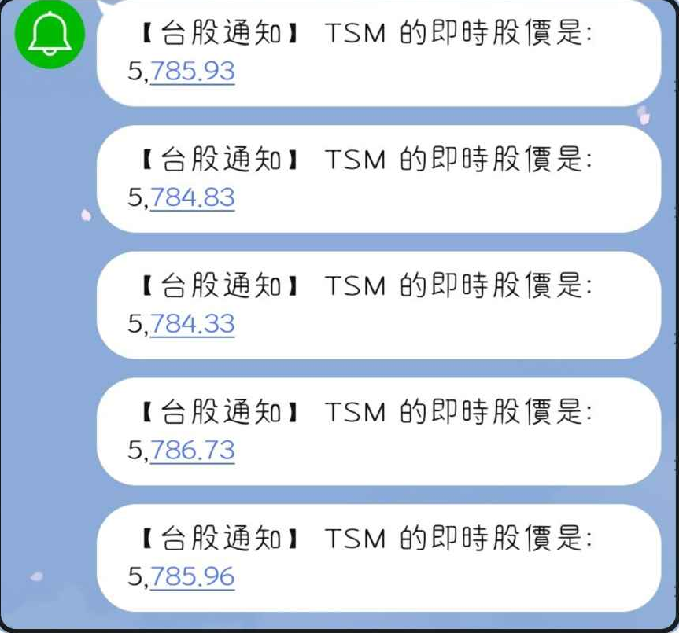
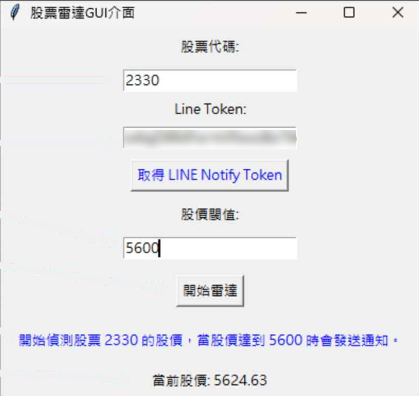

# 股票雷達 Stock Radar（個股動態監測通知）

輸入股票代碼和目標價後，程式每 30 秒抓一次股價，達到目標價就通知我。這是我第一次把「抓資料 → 判斷 → 通知」串成一條完整流程的小工具，高三下學期的作品。

<p>
  
  
</p>

左：v2 實際收到的 LINE 通知。右：v2 的 Tkinter 介面（Token 已模糊處理）。

## 動機

回苗栗拜訪阿公時聊到股市。他經常關注股價變動，但對小投資人來說，一直盯盤很累。如果有一個工具能即時追蹤股票、到價時發出提醒，就能省下很多力氣。

## 設計上的選擇

**資料來源：** 當時比較過四種：

| 來源 | 優點 | 缺點 |
|---|---|---|
| Yahoo Finance | 免費、不需要 API Key、可查全球股票 | 非官方，網頁改版就會失效 |
| Alpha Vantage | 有即時與歷史數據、技術指標 | 要註冊 API Key，免費版每天 25 次 |
| TWSE（證交所） | 官方資料、免費 | 只能取得當日股價、只有台股 |
| IEX Cloud | 數據精確 | 需付費 |

一開始自己寫爬蟲，請求一直被網站的防護機制擋下來。測試很多次後，改用不需要 API Key 的 Yahoo Finance。

**通知方式：** 比較過 Telegram Bot、LINE Notify 和 Email。LINE Notify 免費、最簡單、即時，而且 LINE 在台灣普及率高，所以 v2 選它。Email 在比較表裡即時性最差，也比較容易被忽略；但 LINE Notify 在 2025/3/31 停止服務，v3 改用 Gmail SMTP 寄信。

## 執行方式

```bash
pip install -r requirements.txt

# 寄件用的 Gmail 帳號與「應用程式密碼」（不是登入密碼）
# Windows PowerShell
$env:STOCK_RADAR_EMAIL="你的帳號@gmail.com"
$env:STOCK_RADAR_APP_PASSWORD="應用程式密碼"

python GUI.py
```

## 版本演進

| 日期 | 版本 | 變化 |
|---|---|---|
| 2025-03-25 | v1 | 只抓股價，超過閾值就在終端機印出來 |
| 2025-03-30 | v2 | 改用 LINE Notify 推播，加上 Tkinter 介面（這版的 GUI 原始檔沒有保留，只剩截圖）；記住上次通知時的價格，避免每 30 秒重複通知；用 `pyinstaller --onefile --noconsole` 打包成 `START.exe` |
| 2025-04-01 | v3 | 改用 Gmail SMTP 寄信，介面改成輸入收件 Email 並記住上次的輸入 |

## 設計

- `StockRader.py`：`Rader` 類別負責「抓價格」與「判斷要不要通知」。
- `GUI.py`：負責輸入與顯示，按下開始後另開一條 daemon thread 跑偵測迴圈，介面才不會卡住。

## 現在回頭看

- **帳密寫死在程式碼裡**：原始版本把 Gmail 帳號和應用程式密碼直接寫在 `StockRader.py`，上傳前才改成從環境變數讀取（v2 截圖裡的 LINE Token 也是同樣的問題）。這是這個專案學到最重要的一課。
- **其實是在解析網頁，不是用 API**：價格是抓 Yahoo Finance 網頁上的 `fin-streamer` 標籤，Yahoo 一改版就會失效。改用 `yfinance` 套件會穩定很多。
- **每輪會抓兩次價格**：`run_notifier` 先呼叫 `main()`（裡面已經抓過一次），又再呼叫 `get_stock_price()` 更新畫面，應該讓 `main()` 回傳價格就好。
- **從背景執行緒直接更新 Tkinter 元件**：Tkinter 不是 thread-safe，正確做法是用 `window.after()` 把更新丟回主執行緒。
- 類別名稱 `Rader` 是 Radar 的拼字錯誤，保留原樣。
